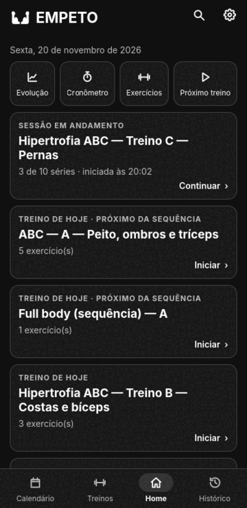
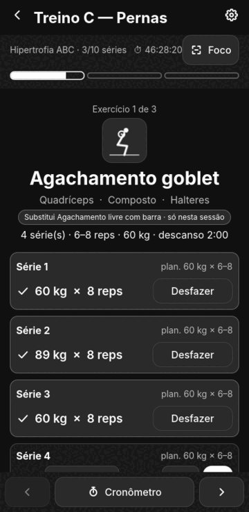
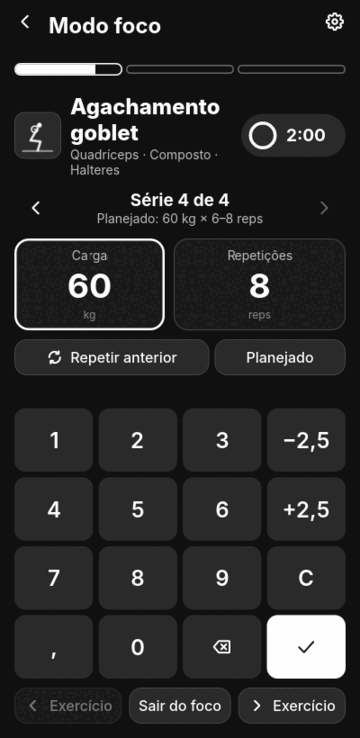
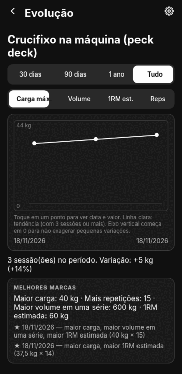
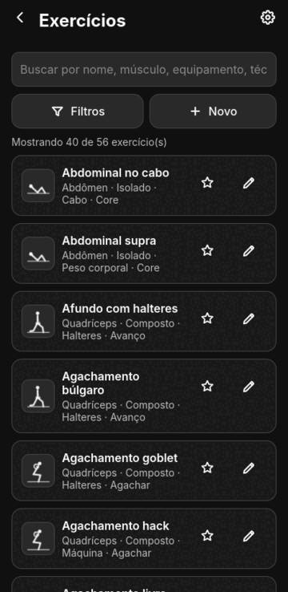
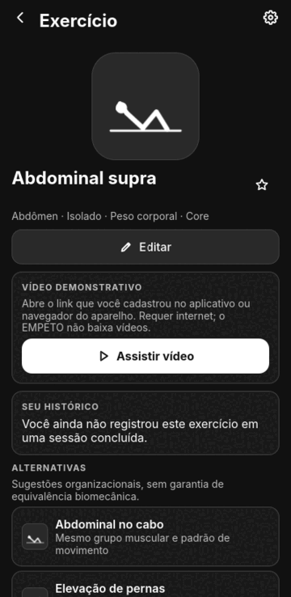
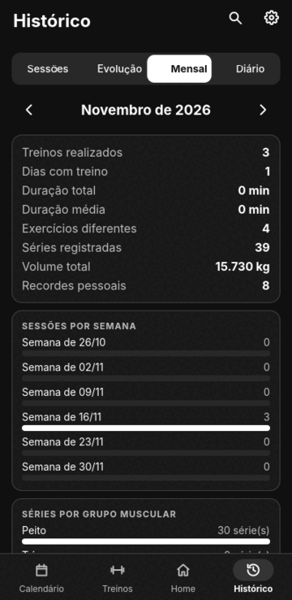
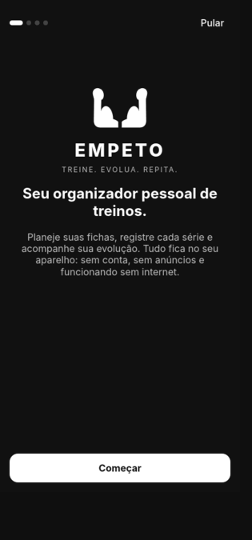

  <picture>
    <source media="(prefers-color-scheme: dark)" srcset="assets/branding/empeto-logo-vertical-dark.svg">
    
  </picture>

<b>TREINE. EVOLUA. REPITA.</b>

  Organizador pessoal de treinos para Android — fichas, execução, cronômetro, histórico e evolução. 
  Funciona sem internet, sem conta e sem anúncios: seus dados ficam no seu aparelho.

  
  
  
  

  
  
  
  

  
  
  
  

## Funcionalidades

- **Fichas** por dia da semana ou em sequência A/B/C, modelos prontos (ABC, Full Body, Push/Pull/Legs), favoritos,
  arrastar para reordenar, tipos de série (aquecimento, drop, falha…) e **superséries/circuitos**.
- **Execução**: registro real de carga e repetições, modo foco com teclado próprio, valores da sessão anterior,
  "repetir com um toque", desfazer, RPE/RIR opcional, calculadoras de **anilhas** e **aquecimento**.
- **Cronômetro** de descanso preciso mesmo com a tela bloqueada, com alertas configuráveis.
- **Biblioteca visual**: ilustrações próprias de cada exercício (offline) e link de vídeo opcional.
- **Histórico e evolução**: recordes pessoais, gráficos com tendência, comparação de sessões, relatório mensal,
  diário de treinamento e calendário com mapa de intensidade.
- **Seus dados seguros**: backup automático semanal no aparelho, backup em arquivo com senha opcional,
  importação/exportação em planilha (XLSX) e recuperação de sessão interrompida.
- **Do seu jeito**: português, inglês e espanhol; tema claro/escuro; tamanho do texto; densidade; animações;
  atalhos da Home; recursos opcionais; widget.
- **Atualizações** verificadas dentro do app (SHA-256 e assinatura conferidos; instalação sempre confirmada por você).

## Baixar e instalar

1. Baixe o `.apk` mais recente em **[Releases](https://github.com/lbraz55/empeto/releases/latest)**.
2. Abra o arquivo no celular e permita "instalar apps desta fonte" quando o Android pedir.
3. Requer Android 8.0 ou mais novo.

Passo a passo, atualização e solução de problemas: **[Guia de instalação](docs/INSTALACAO.md)**.

## Perguntas frequentes

- **Funciona sem internet?** Sim. A internet só é usada, se você permitir, para verificar atualizações.
- **Onde ficam meus dados?** Só no seu aparelho. Desinstalar apaga os dados — salve backups fora do aparelho.
- **Como atualizo?** Configurações › Sobre › Atualizações, ou baixe o APK novo da Release.
- **Como falo com o suporte?** iempetofaq@gmail.com (ou "Fale conosco" no app).

Mais respostas no **[FAQ](docs/FAQ.md)** e no **[Manual do usuário](docs/MANUAL_USUARIO.md)**.

## Permissões

Notificações (alerta do descanso, opcional), vibração, internet (somente atualizações) e instalação de apps
(somente para a atualização que você confirmar). Sem localização, contatos, câmera, agenda ou armazenamento amplo.
Os treinos nunca saem do aparelho.

## Tecnologias

Rust · [Slint](https://slint.dev) · SQLite · Java/JNI (ponte Android) · GitHub Actions. Sem Gradle: o APK é montado
por `scripts/build-apk.sh`.

## Para desenvolvedores

- [Guia de desenvolvimento e reutilização](docs/DESENVOLVIMENTO.md) — ambiente, executar, gerar APK, testes, como contribuir
- [Arquitetura](docs/ARQUITETURA.md) · [Decisões](docs/DECISOES.md) · [Formatos de arquivo](docs/FORMATO_ARQUIVOS.md)
- [Rastreabilidade](docs/RASTREABILIDADE.md) · [Desempenho](docs/DESEMPENHO.md) · [Histórico de versões](CHANGELOG.md)

## Aviso

O EMPETO é um organizador de treinos. Não é ferramenta de diagnóstico, prescrição ou recomendação médica e não
substitui orientação profissional.

## Licença

O `Cargo.toml` declara GPL-3.0-only; a confirmação final da licença pelo autor está pendente. Licenças do Slint e
das dependências: **[docs/LICENCAS.md](docs/LICENCAS.md)**.
