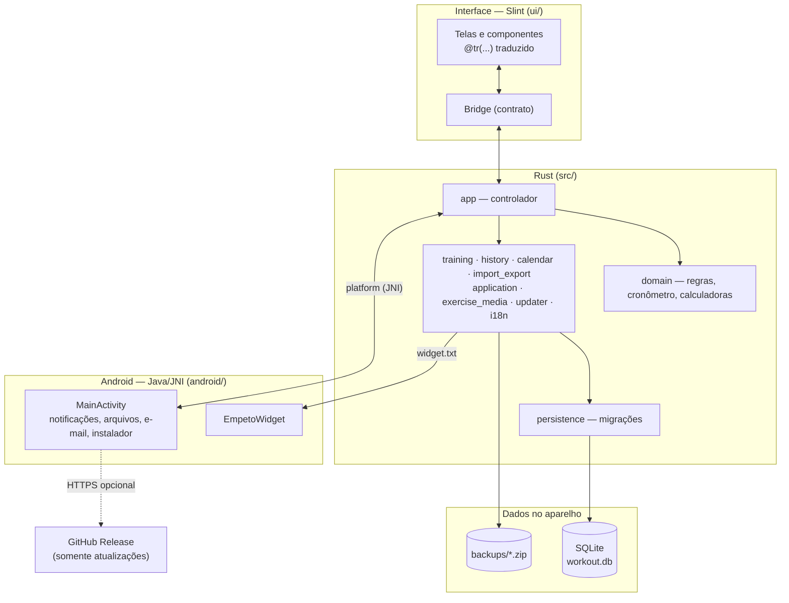

# Arquitetura




```
┌──────────────── UI (Slint) ────────────────┐
│ ui/app.slint · screens/* · dialogs · Bridge │  propriedades + callbacks
└───────────────────────┬────────────────────┘
                        │
              src/app (Controller)              navegação, estados de tela, diálogos
                        │
   ┌──────────┬─────────┼───────────┬──────────────┬────────────┐
 training   history  calendar  import_export   application    platform
 (fichas,   (sessões, (planejado (XLSX, backup,  (preferências) (Android JNI /
 sessões)   evolução) × realiz.)  ICS)                          desktop)
   └──────────┴─────────┴───────────┴──────────────┘
                        │
                 domain (entidades, regras, cronômetro)
                        │
              persistence (SQLite, migrações, transações)
```

| Módulo | Responsabilidade (seção 3.2) |
|---|---|
| `ui/` | Telas, navegação, estados visuais, validação simples de entrada |
| `src/app` | Casos de uso acionados pela UI; conversão de dados para exibição |
| `src/domain` | Entidades, validações, conversões (gramas, reps, descanso), snapshot, **cronômetro** |
| `src/training` | Biblioteca de exercícios, fichas, dias, exercícios da ficha, sessões em andamento |
| `src/history` | Sessões concluídas, resumo, evolução por exercício |
| `src/calendar` | Datas locais × UTC, grade do mês/semana, treinos planejados por data |
| `src/import_export` | Leitura/prévia/mapeamento XLSX, exportação XLSX, backup/restauração, ICS |
| `src/persistence` | Conexão, PRAGMAs, migrações versionadas e transacionais, preferências |
| `src/platform` | `AndroidAdapter`: notificações, vibração, alarmes, seletor de arquivos, ciclo de vida |
| `src/application` | Casos de uso transversais: preferências, busca global, desfazer, `GestureEvent`, atalhos da Home, armazenamento e backups locais, resumo do widget |
| `android/java` | `MainActivity` (NativeActivity + ponte), `LauncherActivity` (entrada do app; sempre abre a interface), `TimerAlarmReceiver` e `EmpetoWidget` |

## Atualizações (evolução v1.1, 7) — `src/updater`

```
Rust (updater)                         Java (MainActivity)                    Android
METADATA_URL ─► updateCheck(url) ─────► HttpURLConnection (HTTPS) ──────────► GitHub Release
parse_metadata/evaluate ◄─ pollUpdateCheck
"Baixar e instalar" ─► updateDownload(url, sha256, size) ─► cache/update/*.apk + SHA-256
                                       verifyApk: pacote, versionCode, assinatura
installApk(path) ──────────────────────► PackageInstaller (sessão) ─► confirmação do usuário
                                       UpdateInstallReceiver ─► status
```

- `is_official_url`: só `github.com/lbraz55/empeto` (ou o nome antigo do mesmo repositório) e `.apk`.
- `pick_apk`: escolhe pelo `Build.SUPPORTED_ABIS`. `auto_check_due`: 7 dias, preferências `update.*`.
- CI: `scripts/update-metadata.py` gera `dist/empeto-update.json` e o anexa à Release.

## Análise (evolução v1.1, 8.4, 8.7–8.9) — `history::analytics`

- `set_set_effort`/`set_session_feeling`: só em sessão em andamento; gatilho `trg_session_feeling_immutable`.
- `session_stats` (comparação), `comparable_sessions`, `month_report` e `diary`: consultas agregadas no SQLite;
  aquecimento fora de volume/carga máxima/1RM. A comparação é montada no controlador (`refresh_compare`).
- Compartilhar: `Platform::share_text` → `MainActivity.shareText` (ACTION_SEND com seletor; sem permissão).
- Desempenho: `tests/bench.rs` + docs/DESEMPENHO.md.

## Eficiência de treinamento (evolução v1.1, 8.1–8.6)

- `domain::SetKind` (+ `parse_set_kinds`/`format_set_kinds`): tipo planejado em `plan_exercise.set_kinds`
  (lista por série) e registrado em `session_set.set_kind`. Recordes e progressão ignoram aquecimento.
- `training::groups` (`training_groups`): grupos = exercícios consecutivos com a mesma `group_tag`;
  `toggle_link`/`normalize` (após mover/remover) e `after_set` (navegação sem descanso dentro do grupo).
- `domain::calculators`: `plates_for` (programação dinâmica limitada pelos pares disponíveis, mínimo de anilhas)
  e `warmup_sets`. Preferências: `plates.available`, `plates.bar_g`, `warmup.steps`.

## Mídia dos exercícios (evolução v1.1, 5.1/5.2)

- `src/exercise_media`: lista de ilustrações (ids estáveis), sugestão automática por padrão de movimento,
  `resolve()` (escolhida → sugerida → genérica) e validação de links de vídeo (somente `https://`).
- `ui/components/exercise_art.slint`: `@image-url` dos SVGs com `colorize: Theme.text` (segue o tema).
- Vídeos: `Platform::open_url` → `MainActivity.openUrl` (Intent ACTION_VIEW, sem permissão). Pacotes de
  mídia baixáveis (alternativa C do documento) entrariam como outra fonte em `exercise_media` sem mudar a UI.

## Localização (evolução v1.1, 4.1)

- Texto-fonte em português; catálogos `resources/i18n/en|es/LC_MESSAGES/workout.po`.
- Slint: frases com `@tr("…")`, embutidas na compilação (`with_bundled_translations`, sem contexto padrão).
- Rust: `crate::i18n::tr("…")` e `trf!("… {} …", args)` leem os mesmos `.po` (parser mínimo em `src/i18n`).
- `Controller::apply_language` escolhe o idioma (preferência `ui.language` ou sistema via JNI `localeTag()`),
  chama `slint::select_bundled_translation` e refaz os textos montados pelo Rust.
- `scripts/i18n.py update|check|merge` mantém os catálogos; `tests/i18n.rs` confere marcadores `{}`.

## Personalização (EMPETO, Fase 5)

- **Gestos**: a UI só emite `Bridge.gesture(contexto, gesto)`; `application::gestures::resolve` decide a
  ação (modo foco: série anterior/próxima; calendário: período anterior/próximo). Todo gesto tem botão
  equivalente; com o módulo desligado `resolve` devolve `None` e a UI desativa o `SwipeGestureHandler`.
- **Atalhos da Home**: códigos estáveis em `application::shortcuts` (preferência `home.shortcuts`);
  `normalize` descarta desconhecidos e duplicados e limita a 4; `set_slot` troca posições em vez de duplicar.
- **Módulos opcionais** (`module.*` nas preferências): só controlam a exibição; nenhum dado é apagado.
- **Animações**: tokens em `ui/themes/tokens.slint` (`anim-*`, `decorative`) resolvidos pelo Rust a partir
  de tema, velocidade, modo do sistema e do módulo de animações decorativas.

## Armazenamento e backups (EMPETO, Fase 6)

- `application::storage`: relatório de espaço (banco + WAL/SHM, `backups/`, `tmp/`, total) e limpeza de
  temporários (nunca toca no banco nem nos backups).
- Backups locais em `files/backups/` usam o mesmo formato e a mesma validação do backup em arquivo
  (`import_export::backup`). Restaurar um backup local copia o arquivo para `tmp/` e segue o fluxo normal.
- Backup automático semanal ao abrir o app (`run_auto_backup`): só com dados, desligável
  (`backup.auto`), mantém os 4 automáticos mais recentes; os manuais nunca são removidos sozinhos.
- Lembrete de cópia externa: `backup.last_external` só é gravado quando o usuário salva um backup
  pelo seletor do sistema — o app nunca afirma que existe uma cópia externa.
- **Widget**: o Rust grava `files/widget.txt` (resumo derivado do cartão principal da Home) e chama
  `MainActivity.updateWidget()`; `EmpetoWidget` (Java) só lê esse texto. Não há segunda fonte de dados
  nem permissões novas.

## Integridade e histórico (3.4)

- Snapshot JSON da ficha (`plan_snapshot_json`) gravado ao iniciar a sessão.
- `session_exercise` guarda nomes/atributos do exercício original e do realizado + tipo de substituição.
- Catálogo (`exercise`) separado da ocorrência na ficha (`plan_exercise`) e na sessão (`session_exercise`).
- FKs com `ON DELETE SET NULL` para sessões, gatilhos que impedem alterar/excluir sessões concluídas.
- Datas em epoch ms UTC; conversão para o fuso local só na interface.
- Cargas em gramas inteiros.
- `PRAGMA user_version` + migrações em transação; cópia do banco antes de migrar.

## Cronômetro (3.6)

`domain::timer::TimerState` guarda o instante de término (`end_boot_ms`, `end_wall_ms`) e o restante
quando pausado. A UI apenas exibe `remaining(now)`; o estado é persistido em `app_preference` a cada
mudança e restaurado ao abrir. Detalhes de comportamento em [DECISOES.md](DECISOES.md).

## Empacotamento (5.2)

`scripts/build-apk.sh`: `cargo ndk` → `libworkout.so` por ABI; `aapt2` compila recursos e gera
`R.java`; `javac` + `d8` geram `classes.dex`; bibliotecas entram sem compressão, `zipalign -P 16`
(páginas de 16 KB) e `apksigner`. O backend Android do Slint compila seu próprio helper Java e o
carrega em memória (requer `ANDROID_HOME`/`ANDROID_JAR` no build).

Versões fixadas: `Cargo.lock` (dependências Rust), NDK 30 no CI (exigido pelo Skia pré-compilado), platform 36, build-tools 36, JDK 21.

## Testes (seção 4)

- Unitários em cada módulo (`cargo test --lib`): conversões, cronômetro (CT-06/07), reconhecimento
  de cabeçalhos, migrações, preferências.
- Integração em `tests/integration.rs`: CT-01 a CT-12 (exceto os que dependem do aparelho) +
  imutabilidade no banco, sequência A/B/C, calendário, exportação ida e volta, manifesto mínimo.
- Desktop: `cargo run --bin workout-desktop` para validar telas.
- Em aparelho real (manual, ver checklist em RASTREABILIDADE.md): suspensão, tela bloqueada,
  notificações, vibração, permissões, rotação.
