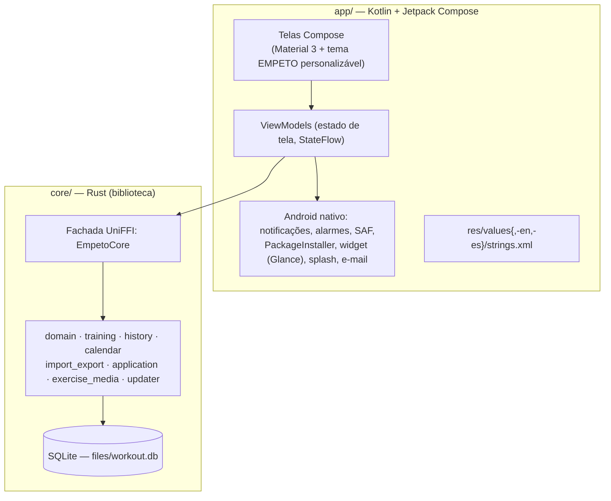

# Plano de migração da interface para Kotlin + Jetpack Compose

Status: **planejamento** (nada foi migrado ainda) · Versão de partida: 0.9.1 · Data: 23/11/2026

## 1. Objetivo

Trocar a camada de interface (Slint) por **Kotlin + Jetpack Compose**, para ter:

- interface nativa do Android, com menos bugs de plataforma (teclado, rolagem, gestos do sistema, acessibilidade);
- **personalização profunda** ("o app com a cara do usuário"): cor de destaque, cores do papel de parede
  (Material You), AMOLED, cantos, fontes, estilos de cartão, fundo, desfoque real, temas salvos e compartilháveis;
- menos código de ponte JNI (notificações, arquivos, instalador, widget passam a ser Kotlin nativo).

**Mantendo**: o núcleo em Rust (regras, banco SQLite, backups, importação/exportação, cálculos — ~8 mil linhas e
97 testes), os dados do usuário, o formato de backup e a mesma identidade do app no Android.

## 2. Princípios (não negociáveis)

1. **Nenhum dado perdido**: mesmo `applicationId` (`com.academialuis.workout`), mesmo banco (`files/workout.db`),
   mesma tabela de preferências, mesmo formato de backup, **mesma chave de assinatura** → a versão Kotlin instala
   por cima da versão Slint e abre os mesmos dados.
2. **Regras de negócio só no Rust**: a interface Kotlin não faz SQL nem recalcula regras.
3. **Offline-first e mesmas permissões** (notificações, vibração, internet só para atualizações, instalação
   confirmada).
4. **Paridade antes de novidade**: a 1.0 Kotlin só substitui a 0.9.x quando todos os itens da seção 9 passarem.
5. **A versão Slint continua publicável** até a paridade (só correções).

## 3. Arquitetura alvo



- **Ponte Rust ↔ Kotlin: UniFFI** (Mozilla). Gera automaticamente as classes Kotlin a partir de anotações no
  Rust — sem JNI escrito à mão, com tipos seguros (records, enums, erros).
- **O que sai do Rust**: `src/app` (controlador ligado ao Slint, ~5,7 mil linhas), `src/platform` (JNI),
  `ui/` (Slint) e as dependências `slint`, `jni`, `android_logger`. A lógica de apresentação útil (formatação de
  datas/cargas, montagem dos cartões da Home, comparação) vira funções da fachada ou vai para os ViewModels.
- **O que fica no Rust**: todos os módulos de regra e persistência, as migrações e os testes atuais.

### 3.1 Esboço da fachada

```rust
#[uniffi::export]
impl EmpetoCore {
    fn open(data_dir: String, lang: String) -> Result<Arc<Self>, CoreError>;
    // Home / fichas / biblioteca
    fn home_cards(&self) -> Vec<HomeCard>;
    fn plans(&self) -> Vec<PlanSummary>;  fn plan(&self, id: i64) -> PlanDetail;  /* criar, editar… */
    fn exercises(&self, filter: ExerciseFilter, limit: u32) -> ExercisePage;
    // Sessão
    fn start_session(&self, day_id: i64) -> Result<i64, CoreError>;
    fn session(&self, id: i64) -> SessionView;  fn record_set(&self, set_id: i64, load_g: i64, reps: i64) -> RecordResult;
    // Histórico e análise
    fn history(&self, limit: u32) -> Vec<SessionSummary>;  fn evolution(&self, key: String, period: Period) -> Evolution;
    fn compare(&self, a: i64, b: i64) -> Comparison;  fn month_report(&self, y: i32, m: u32) -> MonthReport;
    // Dados
    fn create_backup(&self, path: String, password: Option<String>) -> Result<(), CoreError>;  /* restaurar, importar… */
    fn prefs(&self) -> Prefs;  fn set_prefs(&self, p: Prefs);
}
```

O banco fica atrás de um `Mutex` no Rust; o Kotlin chama a fachada em `Dispatchers.IO` e expõe `StateFlow` às telas.

## 4. Sistema de tema personalizável (feito desde o início)

Em vez de cores fixas, a interface Compose lê um **`EmpetoTheme`** montado a partir de um "tema do usuário":

| Ajuste | Opções | Observação |
|---|---|---|
| Base | Claro, Escuro, Seguir sistema, **AMOLED** (preto total) | |
| Cor de destaque | Monocromático (padrão EMPETO), paletas prontas, seletor livre | |
| **Cores do papel de parede** | Material You (Android 12+) | fallback automático em versões antigas |
| Contraste | Normal / alto | acessibilidade |
| Cantos | 0–28 dp (quadrado → arredondado) | `Shapes` do Material 3 |
| Fonte | Sistema + 2–3 fontes embutidas | cada fonte soma ~100–300 KB |
| Tamanho do texto / densidade | mantidos da versão atual | |
| Cartões | Preenchido, contorno, elevado, **vidro** | vidro = desfoque real (`RenderEffect`, Android 12+) |
| Fundo | Liso, gradiente, foto do usuário | foto escolhida pelo seletor do sistema |
| Cronômetro | Anel, número grande, barra | |
| Home | Reordenar/ocultar cartões, atalhos | |
| Movimento | Velocidade, decorativas on/off, transições | mantidos e ampliados |
| Ícone do app | Claro, escuro, monocromático | `activity-alias`, sem permissão |
| **Temas salvos** | Salvar, trocar, **exportar/importar** (`.empetotheme`, JSON) | compartilhar com amigos |

A identidade monocromática continua sendo o **padrão**; a personalização é opcional e tudo tem "restaurar padrão".

## 5. Build, CI e ambiente

- **Gradle** com Android Gradle Plugin, Kotlin e Compose (BOM). Módulos: `app` (Kotlin) e `core` (Rust).
- O Rust é compilado por `cargo-ndk` numa tarefa do Gradle (arm64-v8a e x86_64) e o UniFFI gera os bindings.
  NDK 30 continua.
- **CI**: o job de testes Rust continua; novo job `./gradlew test assembleRelease` + testes de UI no emulador;
  Release, `empeto-update.json` e assinatura pelos mesmos Secrets.
- **Pré-requisito deste ambiente de desenvolvimento**: liberar o acesso a `dl.google.com` / `maven.google.com`
  (repositório do Android Gradle Plugin e do Compose), hoje bloqueado aqui. No GitHub Actions já funciona.
- Traduções: os catálogos `.po` atuais são convertidos por script para `strings.xml` (pt-BR padrão, `-en`, `-es`).
  Mensagens geradas pelo Rust (erros, avisos de importação) continuam no catálogo do Rust.

## 6. Etapas

Cada etapa termina com testes passando, documentação atualizada e um commit; nenhuma publica a versão Kotlin
como "latest" antes da etapa M7.

| Etapa | Entrega | Critério de aceite |
|---|---|---|
| **M0 — Preparação** | Workspace Cargo separando `core` (sem Slint) do app Slint atual; esqueleto Gradle; CI construindo os dois | `cargo test` verde; APK Slint igual ao atual; APK Kotlin "olá mundo" com o núcleo carregado |
| **M1 — Fachada do núcleo** | API UniFFI cobrindo fichas, biblioteca, sessão, histórico, análise, dados, preferências | Testes Rust da fachada + teste Kotlin que abre um banco da 0.9.1 e lê os mesmos dados |
| **M2 — Base da interface** | Tema personalizável (seção 4, estrutura), navegação, splash (SplashScreen API), strings pt/en/es, componentes base | Troca de tema/idioma/fonte em tempo real; screenshots claro/escuro/AMOLED |
| **M3 — Treino** | Home, Treinos/editor (arrastar, grupos, tipos de série), biblioteca e detalhe, sessão, modo foco + teclado, cronômetro (serviço/alarme/notificação), calculadoras | Fluxo completo criar ficha → treinar → finalizar no emulador; cronômetro correto com tela bloqueada |
| **M4 — Histórico e análise** | Histórico, detalhe, evolução (gráfico Compose), comparação, relatório mensal, diário, calendário/heatmap, busca | Números idênticos aos da 0.9.1 para o mesmo banco |
| **M5 — Dados e sistema** | Configurações, importar/exportar (SAF), backups e automático, atualizador, widget (Glance), boas-vindas, FAQ/e-mail, recuperação de sessão | Backup da 0.9.1 restaura na Kotlin e vice-versa; atualização Slint → Kotlin instala por cima |
| **M6 — Personalização** | Todos os itens da seção 4 + exportar/importar temas | Cada ajuste persiste, tem "restaurar padrão" e funciona nos dois temas |
| **M7 — Paridade e lançamento** | Checklist da seção 9, testes de UI, perfil de inicialização (Baseline Profiles), beta no seu aparelho | Checklist 100%; inicialização ≤ a da 0.9.1; lança **1.0.0**; remove Slint e JNI do repositório |

Ordem pensada para que, a cada etapa, haja algo testável no celular (a partir de M3, um APK "beta" separado
pode ser gerado com outro `applicationId`, ex.: `…workout.beta`, para testar sem mexer no app principal).

## 7. Testes

- **Rust**: os 97 testes atuais + testes da fachada.
- **Kotlin**: testes unitários dos ViewModels; testes de UI do Compose (navegação, sessão, idiomas, escala de
  fonte, temas); testes de captura de tela para evitar regressões visuais.
- **Compatibilidade de dados**: um banco de exemplo gerado pela 0.9.1 entra como fixture; a versão Kotlin precisa
  abri-lo e mostrar os mesmos números.
- **Aparelho real** (manual): instalar por cima da 0.9.1, cronômetro em segundo plano, notificações, widget,
  atualizador, seletor de arquivos.

## 8. Riscos e como reduzir

| Risco | Mitigação |
|---|---|
| Troca grande de interface ("big bang") | Núcleo reaproveitado; versão Slint segue publicável; app beta com outro id para testes paralelos |
| Perder dados ao trocar | Mesmo id, mesmo banco, mesma chave; teste automático com banco da 0.9.1; backup antes de atualizar |
| Chave de assinatura diferente | Cadastrar os Secrets **antes** de M5 |
| APK maior | Compose + núcleo Rust estimado em 10–15 MB; R8/minificação; fontes opcionais |
| UniFFI com várias threads | Núcleo com `Mutex`, chamadas em `Dispatchers.IO`, operações longas (backup) com progresso |
| Rede bloqueada neste ambiente | Liberar `dl.google.com` antes de começar M0 |
| Licenças | Mochy-Music é GPL-3.0: usar só como inspiração de ideias, sem copiar código/arte; Compose/AndroidX são Apache-2.0 |

## 9. Checklist de paridade (0.9.1 → 1.0.0)

Fichas (CRUD, dias da semana/sequência, modelos, favoritos, arrastar, tipos de série, grupos, sugestão de progressão) ·
Biblioteca (filtros, paginação, ilustrações, detalhe, vídeo, alternativas, arquivar) ·
Sessão (registro, repetir anterior/planejado, valores anteriores, RPE/RIR, substituição, desfazer, recordes,
progresso, avaliação, observações, recuperação) · Modo foco e teclado · Cronômetro (pré-alerta, preparação,
segundo plano, vibração, sons) · Calendário (mês/semana, heatmap, ICS, agenda) · Histórico (lista paginada, detalhe,
evolução, comparação, relatório, diário) · Busca global · Calculadoras · Dados (XLSX importar/exportar/modelo,
backup com senha, backups locais, automático, armazenamento) · Atualizador · Widget · Boas-vindas · FAQ/e-mail ·
Idiomas pt/en/es · Tema/texto/densidade/animações/gestos/módulos/atalhos · Acessibilidade (rótulos, contraste).

## 10. Decisões para você

1. **Núcleo em Rust + interface Kotlin** (recomendado) ou reescrever tudo em Kotlin (Room no lugar do SQLite em
   Rust; mais trabalho e perde os testes atuais)?
2. **Versão mínima do Android**: manter 8.0 (API 26)? Material You e desfoque real só aparecem no 12+, com fallback.
3. **App beta paralelo** (`com.academialuis.workout.beta`) durante a migração, para você testar sem arriscar os dados?
4. **Numeração**: 1.0.0 para a primeira versão Kotlin com paridade.
5. **Liberar `dl.google.com`/`maven.google.com`** neste ambiente para eu compilar e testar o Compose aqui.
